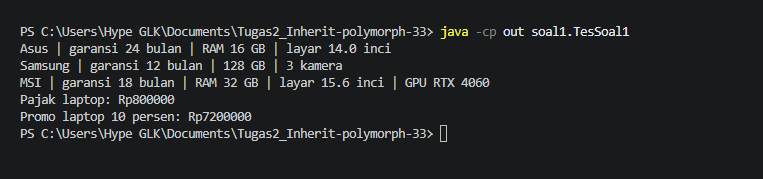
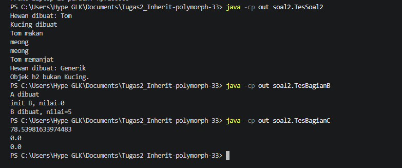
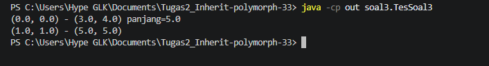
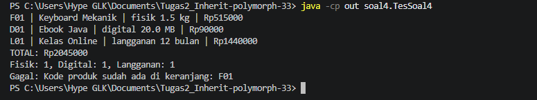

# Tugas 2 Praktikum Pemrograman Berorientasi Objek

## Identitas Mahasiswa

- **Nama:** Zahra Agmelia
- **NPM:** 250810701100033
- **Kelas Praktikum:** A
- **Repository GitHub:** [Tugas2_Inherit-polymorph-33](https://github.com/zahraagmelia/Tugas2_Inherit-polymorph-33)

## Deskripsi Singkat

Tugas ini merupakan implementasi konsep Pemrograman Berorientasi Objek menggunakan bahasa Java. Materi yang diterapkan meliputi inheritance, polymorphism, encapsulation, composition, overriding, overloading, dan exception handling melalui empat soal praktikum.

## Fitur Utama

- **Soal 1:** Implementasi pewarisan kelas perangkat elektronik.
- **Soal 2:** Implementasi inheritance, polymorphism, casting, dan overriding.
- **Soal 3:** Implementasi composition dan pengelolaan objek titik serta garis.
- **Soal 4:** Implementasi mini project toko digital menggunakan konsep OOP.

## Konsep OOP yang Diterapkan

| Konsep | Penerapan |
|---|---|
| Inheritance | Hubungan kelas induk dan kelas turunan |
| Polymorphism | Pemanggilan method sesuai jenis objek |
| Encapsulation | Pengaturan akses atribut dan method |
| Composition | Hubungan objek yang saling memiliki |
| Overriding | Penulisan ulang method dari kelas induk |
| Overloading | Penggunaan beberapa constructor dengan parameter berbeda |
| Exception Handling | Penanganan kondisi kesalahan program |

## Struktur Proyek

```text
Tugas2_Inherit-polymorph-33/
├── src/
│   ├── soal1/
│   │   ├── Perangkat.java
│   │   ├── Laptop.java
│   │   ├── Ponsel.java
│   │   ├── LaptopGaming.java
│   │   └── TesSoal1.java
│   ├── soal2/
│   │   ├── Hewan.java
│   │   ├── Kucing.java
│   │   ├── TesSoal2.java
│   │   ├── TesBagianB.java
│   │   ├── TesBagianC.java
│   │   ├── Lingkaran.java
│   │   └── Titik.java
│   ├── soal3/
│   │   ├── Titik.java
│   │   ├── Garis.java
│   │   └── TesSoal3.java
│   └── soal4/
│       ├── Produk.java
│       ├── ProdukFisik.java
│       ├── ProdukDigital.java
│       ├── Langganan.java
│       ├── Keranjang.java
│       └── TesSoal4.java
├── screenshots/
│   ├── soal1.png
│   ├── soal2.png
│   ├── soal3.png
│   └── soal4.png
├── .gitignore
└── README.md
```

## Prasyarat

- Java Development Kit (JDK)
- Visual Studio Code
- Extension Pack for Java
- Git

## Cara Menjalankan Program

### 1. Kompilasi

Jalankan perintah berikut dari folder utama proyek:

```bash
javac -d out src/soal1/*.java src/soal2/*.java src/soal3/*.java src/soal4/*.java
```

### 2. Menjalankan Program

**Soal 1**

```bash
java -cp out soal1.TesSoal1
```

**Soal 2**

```bash
java -cp out soal2.TesSoal2
java -cp out soal2.TesBagianB
java -cp out soal2.TesBagianC
```

**Soal 3**

```bash
java -cp out soal3.TesSoal3
```

**Soal 4**

```bash
java -cp out soal4.TesSoal4
```

## Screenshot Hasil Program

### Soal 1



### Soal 2



### Soal 3



### Soal 4



## Jawaban Soal dan Analisis Konsep

### Soal 2: Inheritance dan Polymorphism

**1. Output program Bagian A**

Pada implementasi awal sebelum perbaikan casting, program menghasilkan output berikut sebelum berhenti:

```text
Hewan dibuat: Tom
Kucing dibuat
Tom makan
meong
meong
Tom memanjat
Hewan dibuat: Generik
Exception in thread "main" java.lang.ClassCastException
```

Program berhenti karena terjadi kesalahan casting ketika objek `Hewan` dipaksakan menjadi objek `Kucing`.

**2. Kesalahan pada pemanggilan h.panjat()**

Jika komentar pada `h.panjat()` dihapus, program mengalami *compile-time error*. Hal ini terjadi karena variabel `h` memiliki tipe referensi `Hewan`, sedangkan metode `panjat()` hanya tersedia pada kelas `Kucing`.

**3. Penyebab ClassCastException dan perbaikannya**

Kesalahan terjadi pada baris `Kucing k2 = (Kucing) h2;`. Objek `h2` sebenarnya merupakan objek dari kelas `Hewan`, bukan `Kucing`. Perbaikannya adalah menggunakan `instanceof` sebelum melakukan casting agar tipe objek diperiksa terlebih dahulu.

**4. Pemanggilan metode suara() pada h.makan()**

Metode `suara()` yang dijalankan adalah milik kelas `Kucing`, meskipun metode `makan()` berada di kelas `Hewan`. Tipe statis variabel `h` adalah `Hewan`, sedangkan tipe dinamis objeknya adalah `Kucing`. Hal ini menunjukkan penerapan *dynamic method dispatch* dalam polymorphism.

### Bagian B: Pemanggilan Method dalam Constructor

**5. Hasil program dan penyebab nilai 0**

Output program adalah:

```text
A dibuat
init B, nilai=0
B dibuat, nilai=5
```

Nilai `nilai` masih 0 karena konstruktor kelas induk dijalankan sebelum inisialisasi atribut milik kelas anak. Konstruktor kelas induk memanggil metode `init()` yang dioverride oleh kelas `B`, sehingga metode milik `B` dijalankan ketika atribut `nilai` belum diinisialisasi menjadi 5. Pemanggilan metode yang dapat dioverride dari konstruktor sebaiknya dihindari karena dapat menimbulkan hasil yang tidak diharapkan.

### Bagian C: Polymorphism dan Relasi Inheritance

**6. Hasil l3.luas() dan hubungan Titik dengan Lingkaran**

Pemanggilan `l3.luas()` menghasilkan `0.0` karena objek yang dibuat sebenarnya merupakan objek `Titik`, sehingga metode `luas()` milik kelas `Titik` yang dijalankan. Hubungan *is-a* antara `Titik` dan `Lingkaran` kurang tepat karena titik bukan merupakan lingkaran. Jika objek `Titik` digunakan pada program yang membutuhkan lingkaran dengan luas positif, hasil perhitungannya dapat menjadi tidak sesuai dengan kebutuhan program.

### Soal 3: Composition

**1. Apa output baris kedua dan mengapa?**

Pada implementasi awal tanpa defensive copy, output baris kedua adalah `(100.0, 1.0) - (5.0, 5.0)`. Perubahan tersebut terjadi karena objek `Garis` menyimpan referensi objek `Titik` yang sama dengan variabel `t`. Ketika koordinat `t` diubah menjadi 100, titik awal pada `g2` juga ikut berubah.

**2. Bagaimana jika menggunakan defensive copy dan apa outputnya?**

Defensive copy dilakukan dengan membuat objek `Titik` baru berdasarkan koordinat objek yang diberikan. Cara ini membuat perubahan pada objek asli tidak memengaruhi objek `Garis`. Output baris kedua menjadi `(1.0, 1.0) - (5.0, 5.0)` karena koordinat titik awal tetap tersimpan pada nilai awalnya.

**3. Kapan perilaku sebelum dan sesudah defensive copy lebih baik digunakan?**

Perilaku sebelum defensive copy lebih sesuai ketika perubahan objek harus terlihat oleh semua bagian program yang menggunakan referensi yang sama. Perilaku setelah defensive copy lebih sesuai ketika objek perlu menjaga datanya agar tidak berubah akibat modifikasi dari luar.

**4. Apa masalah jika Garis mewarisi Titik?**

Hubungan antara `Garis` dan `Titik` bukan hubungan *is-a*, karena garis bukan merupakan titik. Hubungan yang tepat adalah *has-a*, yaitu garis memiliki dua objek titik sebagai penyusunnya. Penggunaan komposisi lebih sesuai karena struktur kelas menjadi lebih logis dan mudah dikembangkan.

### Soal 4: Inheritance dan Polymorphism

**1. Apa perbedaan overriding dan overloading?**

Overriding adalah penulisan ulang method dari superclass pada subclass dengan nama dan parameter yang sama. Contohnya method `hitungHargaAkhir()` pada kelas `ProdukFisik`, `ProdukDigital`, dan `Langganan`. Overloading adalah pembuatan beberapa method atau konstruktor dengan nama sama tetapi parameter berbeda.

**2. Apa perbedaan inheritance dan composition?**

Inheritance menunjukkan hubungan pewarisan antara superclass dan subclass. Contohnya `ProdukFisik` dan `ProdukDigital` mewarisi kelas `Produk`. Composition menunjukkan hubungan bahwa suatu kelas memiliki objek dari kelas lain. Contohnya `Keranjang` memiliki daftar objek `Produk` menggunakan `ArrayList`.

**3. Mengapa cetakStruk() tidak menggunakan instanceof?**

Method `cetakStruk()` tidak memerlukan `instanceof` karena setiap objek produk memiliki method `hitungHargaAkhir()` dan `deskripsi()`. Polymorphism memungkinkan Java menjalankan method sesuai jenis objek sebenarnya.

**4. Mengapa hitungPerJenis() menggunakan instanceof dan downcasting?**

Method `hitungPerJenis()` perlu membedakan produk fisik, digital, dan langganan. `instanceof` digunakan untuk memeriksa jenis objek sebelum downcasting. Pemeriksaan `Langganan` harus dilakukan terlebih dahulu karena `Langganan` merupakan subclass dari `ProdukDigital`.

## Batasan dan Pengembangan Lanjutan

Program dibuat untuk menerapkan konsep dasar Pemrograman Berorientasi Objek sesuai dengan materi praktikum. Pengembangan selanjutnya dapat dilakukan dengan menambahkan validasi data yang lebih lengkap, pengelolaan produk, serta fitur penyimpanan data.

## Repository GitHub

Seluruh source code tugas dapat diakses melalui repository berikut:

[https://github.com/zahraagmelia/Tugas2_Inherit-polymorph-33](https://github.com/zahraagmelia/Tugas2_Inherit-polymorph-33)